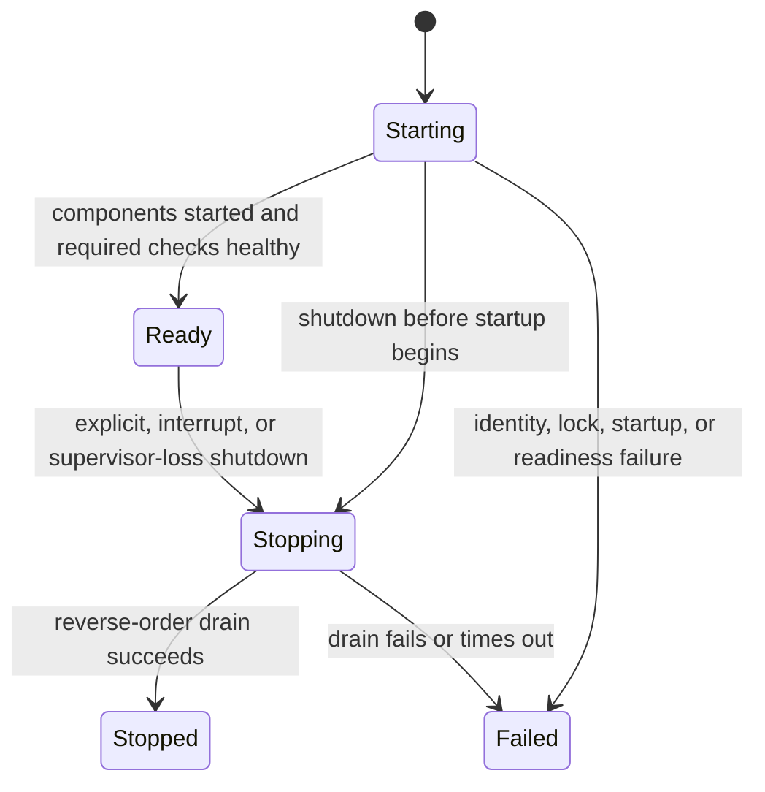

# Extend the engine runtime lifecycle safely

`eitmad-engine-runtime` is the Rust authority for starting, observing, and stopping one engine process. It supplies the same lifecycle behavior to supervised desktop and independent headless launchers; diagnostic mode reuses non-mutating health checks without becoming an authority.

## Ownership and boundaries

| Concern | Authority |
| --- | --- |
| External lifecycle, identity, health, diagnostic, and error shapes | `eitmad-contracts::runtime` and `eitmad-contracts::errors` |
| Component order, readiness, deadlines, rollback, shutdown, and authority lock | `eitmad-engine-runtime` |
| CLI arguments, stdout/stderr adaptation, Ctrl+C, and supervisor stdin EOF | `eitmad-engine-cli` |
| Windows process containment, restart budget, stale-event rejection, and shell-owned shutdown | [Windows process supervision](windows-process-supervision.md) |
| Typed local command/query transport | `eitmad-engine-runtime::local_ipc`; delegates shutdown to this lifecycle |
| SQLite authority-store startup and compatibility health | `AuthorityStoreComponent` and `AuthorityStoreHealthCheck`; storage semantics remain in `eitmad-storage` |

The CLI stops and joins local IPC before calling reverse-order runtime shutdown. This prevents requests from reaching the dispatcher after the authority-store component begins draining.

The CLI does not own business logic, storage, authorization, or diagnostics policy. The supervisor PID and inherited stdin control pipe only coordinate process lifetime; neither proves identity or grants authorization.

## Lifecycle and readiness



The normal transition path is `Starting → Ready → Stopping → Stopped`. `Failed` is terminal. Component startup and readiness checks each receive a separate 30-second deadline by default, so a slow component cannot consume the readiness-check budget or change failure attribution. Shutdown receives one total 10-second deadline. Tests may configure shorter deadlines through `RuntimeBuilder`.

Readiness is not the same as process liveness:

- `live` is true in `Starting`, `Ready`, and `Stopping`;
- `ready` is true only in `Ready` while every `RequiredForReadiness` check is `Healthy`;
- an advisory non-healthy check degrades aggregate health without blocking readiness;
- a required non-healthy check blocks startup or makes a refreshed ready runtime unready.

`RuntimeComponent` implementations start in registration order and stop in reverse order. A partial startup failure stops every component that already started before releasing the authority lock. Components return an opaque `ComponentFailure`; raw causes do not cross the public diagnostic boundary.

The authority store is the first product component registered by the CLI. It applies and verifies private directory/file permissions, then opens and transactionally migrates `eitmad.sqlite3` only after the authority lock is held and before readiness. Normal readiness runs quick integrity against that already-open handle. It does not reopen or copy the database. Diagnostic mode does not start the component; its read-only compatibility check accepts an absent pre-first-start database and reports an existing corrupt, newer, or migration-incompatible database as unhealthy after testing migrations against an in-memory copy.

## Performance diagnostics and bounds

Every `HealthCheckResult` and `DiagnosticReport` includes measured elapsed microseconds. The report also returns `PerformanceExpectations` for startup, idle CPU and working set, common query and command latency, background-sync batch size, and background-sync cycle time. These fields are stable diagnostic evidence, not a promise that one development machine will meet a release-build budget.

Startup publication recovery reads at most 64 rows per storage page and stops after 1,024 rows. Local IPC accepts at most 64 in-flight requests per connection. These bounds prevent a large backlog or chatty client from creating unbounded startup or task work. Use [Diagnose runtime performance](../../troubleshooting/runtime-performance.md) for the measurement procedure and escalation evidence.

## Process identity and single authority

Every launch receives a new `EngineInstanceId` plus PID, mode, Unix start time, product version, and protocol version. PID reuse means PID alone is never identity or authentication.

Authoritative modes acquire `engine.authority.lock` under the platform runtime-data directory. The OS lock, not the file contents, enforces exclusivity. The JSON contents support local correlation only. A crash releases the OS lock; a replacement process safely overwrites stale metadata. Diagnostic mode does not acquire the lock or start runtime components.

The current lock is one authority per runtime directory. Future scoped multi-engine support must define an authority key and migration before changing that rule.

## Structured failures and privacy

Lifecycle failures use `ContractError` with a stable error code, localization message ID, retry disposition, correlation ID, and `LifecycleStage`. Current identifiers are in the [generated protocol reference](../../_generated/contracts-v1.md).

Public snapshots and stderr output exclude raw I/O errors, component errors, paths, secrets, product payloads, customer data, and authorization graphs. Native shells must localize `messageId`; they must not parse Rust prose. Machine fields remain locale-independent UTF-8 JSON. No Arabic UI is implemented by this subsystem, so RTL rendering is not applicable yet.

## Safe extension points

- Add a `RuntimeComponent` when a capability needs ordered initialization and bounded draining.
- Add a `HealthCheck` with a stable `eitmad.health.*` ID and deliberate readiness impact.
- Keep component-specific behavior inside its owning vertical; the runtime only coordinates it.
- Add external lifecycle fields through the Rust contract evolution and binding-generation workflow.
- Do not use stdout status events as authenticated IPC. Extend the [implemented local IPC boundary](local-ipc.md) behind capability negotiation and the existing runtime state.

## Arabic-first completion record

Lifecycle and diagnostic output is locale-independent machine JSON. Runtime failures carry stable message IDs, retry metadata, correlation IDs, and safe lifecycle details; diagnostics exclude product text and secrets. The Windows shell owns Arabic failure presentation, RTL, focus, and accessibility. See [Windows shell behavior](windows-native-shell.md) and the [Arabic-first feature checklist](../contributing/arabic-first-feature-checklist.md) for presentation verification.

The runtime also composes product dispatch, storage, and background synchronization. Those capabilities have their own Arabic search, data, and recovery requirements; this lifecycle guide does not mark them as unimplemented or exempt them from verification. Use the [repository ownership map](../repository-layout.md) to find their canonical guides.

## Tests and verification

Unit tests beside the runtime cover transitions, order, rollback, required and advisory health, separate component-startup and readiness-check deadlines, shutdown deadlines, identity uniqueness, diagnostic isolation, and lock replacement. CLI integration tests cover process readiness, stdin-EOF shutdown, invalid supervision, diagnostics, duplicate processes, and exit codes. Windows adapter tests cover intentional stop, unexpected death, restart exhaustion, stale events, Job Object timeout termination, and the real engine lifecycle.

Run the focused checks:

```powershell
cargo test -p eitmad-engine-runtime -p eitmad-engine-cli
```

Then [run and diagnose the engine](../../operations/run-engine-runtime.md) or [resolve startup failures](../../troubleshooting/engine-startup-failures.md).
